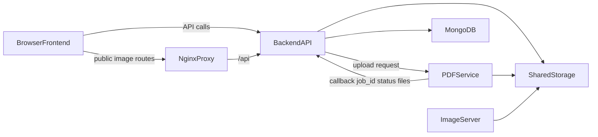

# Reading Pal Architecture

This document describes the current architecture as implemented in the codebase.

## Service Boundaries

## Frontend (`frontend/`)

- React 18 SPA entry: `frontend/src/index.js`
- Container static server: `frontend/serve_with_proxy.js` serves the production build and proxies `/api` and `/images` to `host.docker.internal:${BACKEND_PORT}`, preserving the browser `Host` header.
- Route shell and auth token wiring: `frontend/src/App.js`
- Primary pages:
  - `frontend/src/pages/BookList.js`
  - `frontend/src/pages/BookView.js`
  - `frontend/src/pages/LoginPage.js`
  - `frontend/src/pages/AuthCallbackPage.js`
  - `frontend/src/pages/AdminLoginPage.js`
  - `frontend/src/pages/UserManagementPage.js`
  - `frontend/src/pages/PromptSettingsPage.js` (`/settings/prompts`)

Frontend calls backend endpoints under `/api/*` and renders book markdown with image URLs that are rewritten to backend app-image routes.

## Backend API (`backend/`)

- Entry point: `backend/main.py`
- Mounted routers:
  - `/api/auth` -> `backend/api/auth_routes.py`
  - `/api/books` -> `backend/api/books.py`
  - `/api/notes` -> `backend/api/notes.py`
  - `/api/llm` -> `backend/api/llm.py`
  - `/api/bookmarks` -> `backend/api/bookmarks.py`
- Data layer: `backend/db/mongodb.py`
- LLM/service logic:
  - `backend/services/llm_service.py`
  - `backend/services/cleanup_service.py`

Backend is the system-of-record service for user, book, note, bookmark, and reading-guide data.

### Whole-book reading guides

- Up to **5** roadmap instances per book per user in MongoDB collection `reading_guides`, keyed by `(book_id, user_id, guide_id)`.
- Per-guide progress in `reading_guide_progress` (also keyed by `guide_id`).
- Per-card LLM chat threads in `reading_guide_card_chats` (`book_id`, `user_id`, `guide_id`, `card_id`).
- API routes under `/api/books/{book_id}/reading-guides/...` (legacy `/reading-guide` aliases default guide `guide_id=default`).
- `POST /reading-guides` accepts optional `custom_requirements`, `prompt_depth` (`compact` | `standard` | `high_fidelity`), and `prompt_emphasis` (`balanced` | `author_craft` | `takeaways`). Omitted depth and emphasis keep the existing high-granularity mentor prompts. `high_fidelity` does not cap pillar count. Compact asks segmentation for 4–6 pillars. Stored values are reused on regenerate.
- `GET` and `PUT /api/auth/prompt-config` store optional per-user overrides of the reading-guide generation prompt and card format prompt on the user document (`guide_generation_prompt`, `guide_format_prompt`). Blank or unchanged text clears the override. Toolbar angle, depth, and emphasis are still appended when a guide is generated.

## Document Service (`pdf_service/`)

- Entry point: `pdf_service/app.py`
- Public API: `POST /process-pdf`
- Internal responsibilities:
  - Detect supported source format (`.pdf`, `.epub`, `.mobi`, `.azw`, `.azw3`, `.docx`, `.txt`, `.html`, `.htm`)
  - Route to format-specific extraction/conversion
  - Determine text PDF vs scanned PDF path for PDF uploads
  - Extract text/images when available. EPUB, and MOBI/AZW after conversion to EPUB, resolve each `` inside the zip, write the bytes to `images/app` under a content hash, and rewrite that `src` to `/images/app/<hash>` before markdown conversion. The picture stays in the chapter. Those files use the same callback list as PDF images and are not appended a second time.
  - Produce markdown output
  - Optionally reformat markdown through configured LLM. The upload reformat prompt promotes plain structural titles (Chapter, Part, Section, and front/back matter) to ATX headings. The reader and roadmap also recognize those lines in markdown that was saved before that prompt change, so existing books do not need a reprocess for page breaks or guide sections.
  - Callback to backend with processing result payload

## Image Server (`image_server/`)

- Entry point: `image_server/app.py`
- Routes:
  - `GET /images/public/{...}` for public assets
  - `POST /images/upload` for uploads (optional API key auth)
  - `GET /images/app/{...}` and `GET /images/{...}` for localhost-only app/legacy access

In production routing, app images are typically served through backend signed routes rather than direct browser access to `image_server` app endpoints.

## Runtime Architecture

## Authentication

- User login is Google OAuth (`GET /api/auth/login/google`). The callback issues a JWT whose `user_id` claim is the Mongo user id.
- Local testing can skip Google with `POST /api/auth/dev/login`. That route looks up the existing user `LOCAL_DEV_LOGIN_EMAIL` (default `lgyhz1234@gmail.com`) and returns the same style of user JWT. It does not create a user and does not change that account's Google id. It responds only when `ALLOW_LOCAL_DEV_LOGIN=true`, the browser `Host` is `localhost`, `127.0.0.1`, or a private LAN address (this machine is `10.0.1.22`), and the TCP peer is loopback or a Docker bridge address (`172.16.0.0/12`). Public hosts get 404. The login page shows **Continue as lgyhz1234@gmail** only on localhost and private IPv4 hosts. The admin login page stays at `/admin/login` and is not linked from the public login page.

## Request Flows

## Upload and processing flow

1. Frontend uploads a supported ebook/document to `POST /api/books/upload` (backend).
2. Backend forwards the file to `POST {PDF_CLIENT_URL}/process-pdf`.
3. PDF service returns a `job_id` and starts background processing.
4. Backend stores initial book record with `job_id` and pending status.
5. Worker writes markdown/images and calls backend callback `POST /api/books/callback`.
6. Backend updates the matching book by `job_id` with status, markdown filename, and image metadata.

## Book image flow

1. Markdown contains `/images/app/...` references produced during document processing.
2. Frontend rewrites those paths to `/api/books/images/app/...`.
3. Backend signs and validates app-image requests using `APP_IMAGE_SECRET` query parameters (or bearer auth fallback).
4. Backend reads image files from mounted `IMAGES_PATH`.

## Storage Model

Configured in root `.env` and mounted via `docker-compose.yml`:

- `PDF_STORAGE_PATH`: raw uploaded source files (pdf/epub/docx/txt/html/etc.)
- `MARKDOWN_PATH`: generated markdown
- `IMAGES_PATH`: extracted and uploaded images

Backend, PDF service, and image server use container-internal paths that map to the same host directories.

## Key Architecture Constraints

- Backend runs with `network_mode: host`, so callback and local URLs must account for host networking.
- PDF service is asynchronous by design; frontend must poll processing status.
- Browsers do not include bearer token headers on plain markdown image fetches, so signed URLs are required for protected app-image delivery.
- MongoDB is external to this compose file and must be reachable from containers using the configured URI.
